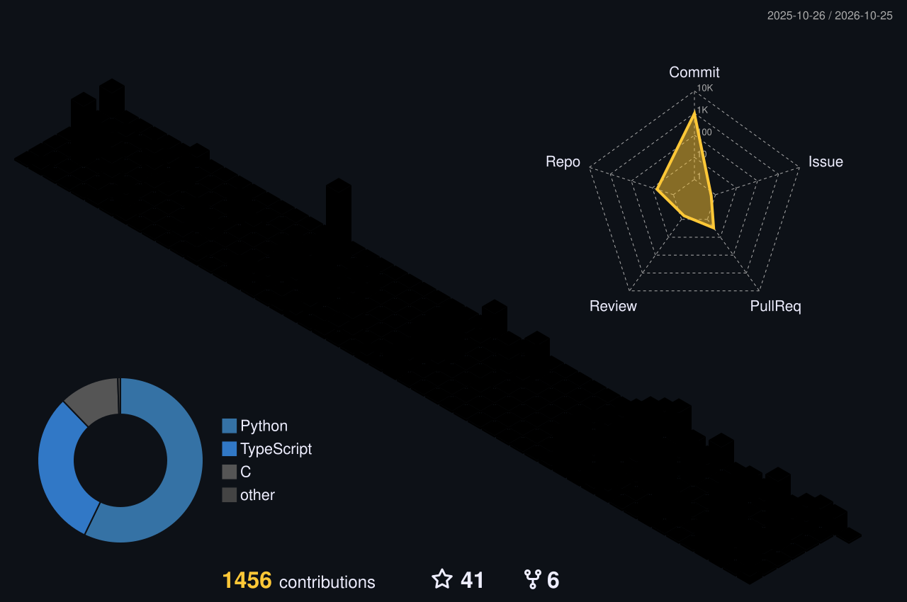

<div align="center"></div>
<h6 align="center">If you send a friend request, please let me know your Discord username. I think I have too many scam friend requests :/</h6>
<br>
<div align="center">
  <a href="https://discords.com/bio/p/atomic09" target="_blank" rel="noreferrer" ></a>
  <a href="https://wakatime.com/@018d9e20-7204-40cc-9d2f-4231bc99a8de" target="_blank" rel="noreferrer"></a>
  
  
</div>

###
👋 Hi! My name is **Atom** (aka. Atomic)<br><br>
🌱 I'm currently interested in **AI/LLM Applications, Software Engineering, Cloud, Cybersecurity, Embedded Systems, and "good" open-source**<br><br>
💻 Sometimes I work on a [**public project**](https://github.com/ATOMIC09?tab=repositories)<br><br>
🖼️ Profile credit is [**here**](https://www.pixiv.net/en/artworks/131699262)

<h1>📌 Featured Projects</h1>

**[RuamLem](https://github.com/ATOMIC09/RuamLem)** — RAG-based Q&A + AI content moderation/guardrails platform for university students (Next.js, Azure OpenAI, Supabase)<br><br>
**[YuukaDiscordBot](https://github.com/ATOMIC09/YuukaDiscordBot)** — AI voice/chat assistant, LangChain agent with 30+ tool integrations, Whisper STT/TTS<br><br>
**[KNACKSAT On-Board Computer](https://github.com/PS-Open-Fruit/OBC_SpaceFruit)** — CubeSat on-board computer (STM32L4), RI2C 2026 Best Paper Award<br><br>
**[TESA Top Gun Rally 2025](https://github.com/PS-Open-Fruit/AI-Drone-Detection)** — AI drone detection & tracking (YOLO11-OBB, OpenCV), 5th place, Defence Innovations & Edge Computing

<details open>
<summary><h1>📈 Stack & Statistics</h1></summary>
<div align="center">

| Front-end | Back-end | General Purpose |
| --------- | -------- | ---------------- |
|         |   |  |

| Cloud / Hosting | Tools | Embedded |
| --------------- | ----- | -------- |
|       |       |  |

| Home Automation | Storage / Network | Operating Systems | Game Engines |
| --------------- | ----------------- | ----------------- | ----------- |
|    |   |      |   |


</div>
<br>

<div align="center">
  
  
  
  
</div>

<div align="center">
  <h1 align="center">🏆 Trophies<h1/>
  
</div>
</details>

<br>
<div align="center">
  <div>
    <h1 align="center">
      
      WakaTime Statistics
    </h1>
  </div>
  <div align="center">
  <!--START_SECTION:waka-->

```rust
From: 11 February 2024 - To: 30 October 2026

Total Time: 883 hrs 32 mins

Python                     272 hrs 34 mins       ⣿⣿⣿⣿⣿⣿⣿⣶⣀⣀⣀⣀⣀⣀⣀⣀⣀⣀⣀⣀⣀⣀⣀⣀⣀   30.85 %
TypeScript                 191 hrs 58 mins       ⣿⣿⣿⣿⣿⣦⣀⣀⣀⣀⣀⣀⣀⣀⣀⣀⣀⣀⣀⣀⣀⣀⣀⣀⣀   21.73 %
JavaScript                 76 hrs 37 mins        ⣿⣿⣄⣀⣀⣀⣀⣀⣀⣀⣀⣀⣀⣀⣀⣀⣀⣀⣀⣀⣀⣀⣀⣀⣀   08.67 %
Markdown                   67 hrs 43 mins        ⣿⣿⣀⣀⣀⣀⣀⣀⣀⣀⣀⣀⣀⣀⣀⣀⣀⣀⣀⣀⣀⣀⣀⣀⣀   07.67 %
C                          64 hrs 27 mins        ⣿⣷⣀⣀⣀⣀⣀⣀⣀⣀⣀⣀⣀⣀⣀⣀⣀⣀⣀⣀⣀⣀⣀⣀⣀   07.30 %
Bash                       35 hrs 58 mins        ⣿⣀⣀⣀⣀⣀⣀⣀⣀⣀⣀⣀⣀⣀⣀⣀⣀⣀⣀⣀⣀⣀⣀⣀⣀   04.07 %
VHDL                       29 hrs 47 mins        ⣷⣀⣀⣀⣀⣀⣀⣀⣀⣀⣀⣀⣀⣀⣀⣀⣀⣀⣀⣀⣀⣀⣀⣀⣀   03.37 %
C++                        25 hrs 24 mins        ⣶⣀⣀⣀⣀⣀⣀⣀⣀⣀⣀⣀⣀⣀⣀⣀⣀⣀⣀⣀⣀⣀⣀⣀⣀   02.88 %
Other                      22 hrs 39 mins        ⣶⣀⣀⣀⣀⣀⣀⣀⣀⣀⣀⣀⣀⣀⣀⣀⣀⣀⣀⣀⣀⣀⣀⣀⣀   02.56 %
```

<!--END_SECTION:waka-->
  </div>
</div>
<br>
